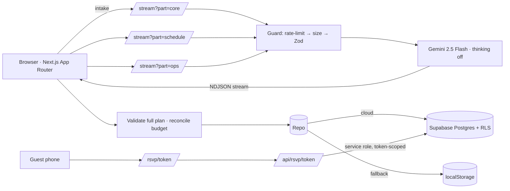

# Utsava (उत्सव) — AI Celebration Planner & Event Manager

> One sentence in → a complete plan streams out in seconds → invite guests per event → collect RSVPs → track every rupee.

Built for **PromptWars Virtual — Celebration & Event Planner**.

## Why it's more than "an AI wrapper"
Researched against Zola, The Knot, Joy and WedMeGood. They all share six pillars — website, guest list, RSVPs, budget tracker, vendor search, accounts — and one blind spot: **one event, one guest list**. Indian celebrations have many events with different guests. Utsava is built around that.

| Pillar | Utsava |
|---|---|
| Planning | Gemini writes budget, schedule, timeline, vendors, themes, risks, invitation — 9 Indian languages |
| Speed | 4 balanced parallel Gemini slices + thinking disabled + live streaming + one-click start (see below) |
| Guests | Multi-event guest × event matrix, paste-import, groups |
| RSVPs | Unique personal link per guest → public RSVP page → responses live in dashboard |
| Money | Verified budget (code reconciles LLM maths) + planned-vs-actual spend tracker with dues & overspend alerts |
| Vendors | AI playbook + your own shortlist → quote → booked pipeline |
| AI Copilot | "Cut 15%" → only the affected slices are revised, ticks preserved, before/after budget shown |
| Accounts | Supabase anonymous auth: real per-user data + RLS, zero login friction |

## Architecture

* **Schema-first:** one Zod schema per slice is the contract for model, API and UI.
* **Stateless server;** all state in Postgres (or local fallback).
* **Security:** RLS on every table; public RSVP route is token-scoped, exposes only that guest's events, rate-limited, validated; prompt delimiters + sanitising; CSP + security headers; service key server-only.

## Planning utility
| Feature | What it does |
|---|---|
| **Next best moves** | Overview card that reads your own data and says what to do now: overdue/upcoming payments, overspent categories, milestones due this week, vendors still unbooked, open high-priority tasks. One tap jumps to the right tab. |
| **Day-of run sheet** | One page for you and your coordinator: minute-by-minute schedule, booked/quoted vendor phone numbers (tap to call), open tasks and payments. Print it or send it on WhatsApp. |
| **RSVP deadline & reminders** | Set a “reply by” date once; it appears on every invitation and on each guest’s RSVP page. One-tap WhatsApp reminders name the events a guest still owes an answer for. |
| **Catering estimate** | From real RSVPs: plates to order (confirmed + half the “maybe”s + buffer) and the resulting cost per plate on your catering budget. |
| **Faster tabs** | Heavy tabs load on demand and are preloaded in the background; printing waits for all of them. |

## End-to-end & accessibility tests
`e2e/` drives the real production build in a real browser against a **fake Gemini server** (no API key, no cost, deterministic), with failure injection (503s, truncated JSON streams):
```bash
npm run build && cd e2e && npm install && npm test     # 31 behaviour checks (uses your installed Google Chrome)
npm run a11y                                           # axe-core: WCAG 2.1 AA on every screen
```
Covers generation (4 parallel slices), duplicate removal, persistence across reload, Copilot streaming / scoped prompts / undo, silent self-healing, rate limiting, cross-origin blocking and mobile layout.

## AI Copilot
| What | How |
|---|---|
| Speed | Streams: the reply and change list appear in about a second while the plan rewrites. Only the plan parts an instruction can affect are sent to, and rewritten by, the model (budget → budget + checklist/vendors, schedule changes → schedule…); broad or unclear requests fall back to the whole plan. |
| Reliability | Failed or malformed output retries silently on the fallback model chain (twice) before any error is shown. |
| Quality | Remembers the last 3 turns, keeps ticked tasks, shows budget before → after, **↶ Undo** restores the previous plan. |
| No duplicates | The model is told never to repeat items, and every result passes through the dedupe engine (below). |

## Duplicate protection
Plans: repeated budget lines (merged, total unchanged), checklist tasks (across all categories, progress and highest priority kept), vendors, milestones (same day only), schedule items, themes, palette colours, notes and risks are merged on generation, after every Copilot change, and once on load for older saved plans. Guests: pasted lists skip people already listed (widening their invitations instead), a “Merge repeated guests” button cleans existing repeats, and `supabase/dedupe.sql` (run once) removes old repeats and adds a unique phone-per-event index. Vendor shortlist: the same vendor can’t be added twice.

## Real data (no paid keys)
| Feature | Source | Notes |
|---|---|---|
| Real nearby vendors & venues with phone, website, address, distance | OpenStreetMap via Overpass (geocoded with Open-Meteo) | One-click “+ Shortlist” into your vendor pipeline. Cached 6 h, rate-limited, attribution shown. |
| Weather for your event date | Open-Meteo | Live forecast ≤ 16 days out; otherwise the same dates over the last 5 years (rain probability, heat, cold) with concrete advice. |
| Guest list export | Your own data | Spreadsheet-safe CSV + “who hasn’t replied” filter for WhatsApp nudges. |

## Production hardening
| Concern | What Utsava does |
|---|---|
| AI outages | Per-slice **silent self-healing**: a failed or malformed slice is retried automatically on a fallback model (`GEMINI_FALLBACK_MODEL` → OpenAI if keyed) at lower temperature; the user only sees an error after two failed heals. Copilot and intake parsing use the same fallback chain server-side. |
| Abuse / cost | Same-origin check on every POST, per-IP rate limits, body-size caps, Zod validation. Set `UPSTASH_REDIS_REST_URL/TOKEN` for a **global** limiter across serverless instances; falls back to in-memory if Redis is down. |
| Data loss | Debounced, serialised, latest-wins save queue with flush on tab hide/close; Postgres size + length constraints; RSVP table is write-locked from the browser. |
| Observability | JSON structured logs, `/api/health` (ai/db/rsvp/rateLimit/build), `npm run smoke` post-deploy checks (also run in CI against the production build). |
| Privacy & SEO | Private pages send `noindex`; `robots.txt`, `sitemap.xml`, web manifest, JSON-LD on the landing page. |
| Print / PDF | A4 print stylesheet with branded header, page-break control and colour-exact output (Save as PDF). |

## Response time
| | v1 | v3 |
|---|---|---|
| Generation | 1 call, ~5-6k tokens, thinking on | **4 balanced parallel calls (~1k tokens each)**, thinking off, ≤20-word strings |
| Landing → plan | parse → review → click Generate | **one click**: parse and start automatically |
| First visible content | after model "thinks" | first tokens (~1 s) |
| Copilot edit | rewrites whole plan | returns only the changed slices |
| Rendering | re-render per token | memoised + `useDeferredValue` |
| Hosting | — | `vercel.json` pins Mumbai (`bom1`); Cloud Run `asia-south1`; Supabase Mumbai |

**Measure it yourself** (real numbers for your LinkedIn post):
```bash
npm run dev            # terminal 1
npm run bench          # terminal 2 — prints first-byte + completion per slice and wall-clock total
BASE_URL=https://your-app.vercel.app npm run bench   # against production
```
Speed/quality dial: `GEMINI_MODEL=gemini-2.5-flash-lite` is faster still, at some cost in richness.

## Design system
Fraunces (soft, optically-sized display) + Inter, with matched Noto fallbacks for Devanagari, Telugu, Tamil, Kannada, Malayalam, Bengali and Gujarati (loaded only when those scripts appear). One container width, a fluid type scale, an 8-pt rhythm, tabular numerals for money, WCAG-AA contrast (RSVP header has a contrast scrim over any theme palette), reduced-motion support.

## Run
```bash
npm install
cp .env.example .env.local      # add GOOGLE_GENERATIVE_AI_API_KEY (+ Supabase keys, see SUPABASE.md)
npm run dev
npm run verify                  # lint + typecheck + tests + build
```

## Deploy
```bash
gcloud run deploy utsava --source . --region asia-south1 --allow-unauthenticated \
  --set-env-vars GOOGLE_GENERATIVE_AI_API_KEY=KEY,NEXT_PUBLIC_SUPABASE_URL=URL,NEXT_PUBLIC_SUPABASE_ANON_KEY=ANON,SUPABASE_SERVICE_ROLE_KEY=SERVICE
```
`NEXT_PUBLIC_*` are baked at build time — with `--source .` Cloud Build reads them from the env at build; on Vercel add them before deploying.

## Tests
154 tests. `tests/` covers save-queue ordering, Redis/in-memory rate limiting, origin checks, model fallback, budget reconciliation, INR parsing, dates, ICS (RFC 5545), rate limiter, prompt-injection, schema validation, multi-event RSVP maths, spend ledger, and a regression for progress preservation.
