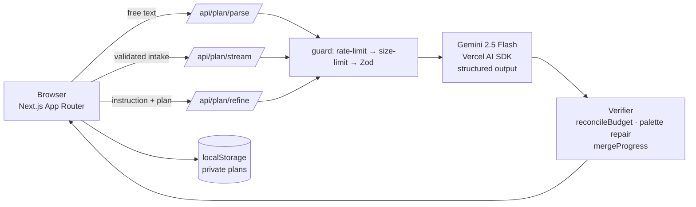

# Utsava (उत्सव) — AI Celebration & Event Planner

> Describe a wedding, birthday or community event in one sentence. Watch Gemini write a complete budget, timeline, vendor playbook and themes **live** — then refine it by asking.

Built for **PromptWars Virtual — Celebration & Event Planner**.

## ✨ What makes it different

| | |
|---|---|
| **Natural-language intake** | "200-guest Telugu wedding in Hyderabad, 25 lakhs" → Gemini fills the structured brief (date, guests, budget, city, language). |
| **Live streaming plan** | `streamObject` + a Zod schema: sections appear on screen as Gemini writes them. |
| **Verified numbers** | LLMs can't add. A deterministic `reconcileBudget()` makes every rupee line sum to the exact total. |
| **AI Copilot** | "Cut 15%", "plan for rain", "add a vegan menu" → whole plan revised, **checklist progress preserved**, budget before → after shown. |
| **9 Indian languages** | Plan *and* WhatsApp invitation in Hindi, Telugu, Tamil, Kannada, Malayalam, Marathi, Bengali, Gujarati, English. |
| **Real-dated timeline** | Anchored to your date, exportable as `.ics`; the model is told how many days remain so it never schedules into the past. |
| **Contingency planning** | Risks (rain, vendor no-show, overruns) each with a mitigation. |
| **No sign-up, private** | Plans live in your browser; nothing stored server-side (stateless → Cloud Run friendly). |

## 🏗 Architecture



* **Stateless server** — no DB, no sessions; deploy anywhere (Cloud Run / Vercel).
* **Schema-first** — one Zod schema is the contract for the model, the API and the UI.
* **Defence in depth** — IP rate limiting, body-size caps, Zod validation on every route, delimiter-safe prompts (`<user_input>` + angle-bracket stripping), strict security headers + CSP, no keys on the client.

## 🎯 Mapped to the judging criteria

| Criterion | Where |
|---|---|
| Problem alignment | Budgets · timelines · vendor checklists · personalised ideas for weddings / birthdays / community events |
| Genuine GenAI | Intake parsing, streamed generation, conversational revision, multilingual output — no hard-coded plans, no demo fallback |
| Code quality | Typed end-to-end, pure logic in `src/lib`, thin routes, small components |
| Security | `src/lib/api.ts`, `next.config.ts`, prompt sanitising (`prompts.ts`) |
| Efficiency | Streaming, `gemini-2.5-flash`, stateless, standalone Docker build |
| Testing | `tests/` — budget maths, INR parsing, dates, ICS (RFC-5545 folding), rate limiter, prompt-injection, schema edge cases |
| Accessibility | Skip link, ARIA tabs with arrow-key nav, labelled forms, live regions, `progressbar`, reduced-motion, focus rings, text alternatives for charts |

## 🔁 Before → after

| Before | After |
|---|---|
| Hard-coded demo plan when AI failed | Real error + retry; **never fake output** |
| Non-functional login/signup forms | Removed — no-account, privacy-first |
| One blocking request, spinner | Live streaming with section progress |
| LLM-written budget (often didn't add up) | Verified by code; badge shows reconciliation |
| Chat replied with a placeholder string | Copilot revises the full plan, keeps progress |
| English only | 9 languages |
| No tests, no CI, PostCSS config missing | 40+ tests, GitHub Actions, Dockerfile, health check |

## 🚀 Run locally

```bash
npm install
cp .env.example .env.local      # add GOOGLE_GENERATIVE_AI_API_KEY (free: aistudio.google.com/apikey)
npm run dev                     # http://localhost:3000
npm run verify                  # lint + typecheck + tests + build
```

## ☁️ Deploy

**Google Cloud Run**
```bash
gcloud run deploy utsava --source . --region asia-south1 --allow-unauthenticated \
  --set-env-vars GOOGLE_GENERATIVE_AI_API_KEY=YOUR_KEY
```
**Vercel:** import the repo, add `GOOGLE_GENERATIVE_AI_API_KEY`, deploy.

## Known limits
Rate limiting is per-instance (swap for Upstash/Redis for a global limit). Prices are AI estimates — always confirm with vendors.
