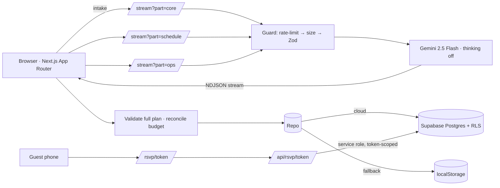

# Utsava (उत्सव) — AI Celebration Planner & Event Manager

> One sentence in → a complete plan streams out in seconds → invite guests per event → collect RSVPs → track every rupee.

Built for **PromptWars Virtual — Celebration & Event Planner**.

## Why it's more than "an AI wrapper"
Researched against Zola, The Knot, Joy and WedMeGood. They all share six pillars — website, guest list, RSVPs, budget tracker, vendor search, accounts — and one blind spot: **one event, one guest list**. Indian celebrations have many events with different guests. Utsava is built around that.

| Pillar | Utsava |
|---|---|
| Planning | Gemini writes budget, schedule, timeline, vendors, themes, risks, invitation — 9 Indian languages |
| Speed | 4 balanced parallel Gemini slices + thinking disabled + live streaming + one-click start (see below) |
| Guests | Multi-event guest × event matrix, paste-import, groups |
| RSVPs | Unique personal link per guest → public RSVP page → responses live in dashboard |
| Money | Verified budget (code reconciles LLM maths) + planned-vs-actual spend tracker with dues & overspend alerts |
| Vendors | AI playbook + your own shortlist → quote → booked pipeline |
| AI Copilot | "Cut 15%" → only the affected slices are revised, ticks preserved, before/after budget shown |
| Accounts | Supabase anonymous auth: real per-user data + RLS, zero login friction |

## Architecture

* **Schema-first:** one Zod schema per slice is the contract for model, API and UI.
* **Stateless server;** all state in Postgres (or local fallback).
* **Security:** RLS on every table; public RSVP route is token-scoped, exposes only that guest's events, rate-limited, validated; prompt delimiters + sanitising; CSP + security headers; service key server-only.

## Response time
| | v1 | v3 |
|---|---|---|
| Generation | 1 call, ~5-6k tokens, thinking on | **4 balanced parallel calls (~1k tokens each)**, thinking off, ≤20-word strings |
| Landing → plan | parse → review → click Generate | **one click**: parse and start automatically |
| First visible content | after model "thinks" | first tokens (~1 s) |
| Copilot edit | rewrites whole plan | returns only the changed slices |
| Rendering | re-render per token | memoised + `useDeferredValue` |
| Hosting | — | `vercel.json` pins Mumbai (`bom1`); Cloud Run `asia-south1`; Supabase Mumbai |

**Measure it yourself** (real numbers for your LinkedIn post):
```bash
npm run dev            # terminal 1
npm run bench          # terminal 2 — prints first-byte + completion per slice and wall-clock total
BASE_URL=https://your-app.vercel.app npm run bench   # against production
```
Speed/quality dial: `GEMINI_MODEL=gemini-2.5-flash-lite` is faster still, at some cost in richness.

## Design system
Fraunces (soft, optically-sized display) + Inter, with matched Noto fallbacks for Devanagari, Telugu, Tamil, Kannada, Malayalam, Bengali and Gujarati (loaded only when those scripts appear). One container width, a fluid type scale, an 8-pt rhythm, tabular numerals for money, WCAG-AA contrast (RSVP header has a contrast scrim over any theme palette), reduced-motion support.

## Run
```bash
npm install
cp .env.example .env.local      # add GOOGLE_GENERATIVE_AI_API_KEY (+ Supabase keys, see SUPABASE.md)
npm run dev
npm run verify                  # lint + typecheck + tests + build
```

## Deploy
```bash
gcloud run deploy utsava --source . --region asia-south1 --allow-unauthenticated \
  --set-env-vars GOOGLE_GENERATIVE_AI_API_KEY=KEY,NEXT_PUBLIC_SUPABASE_URL=URL,NEXT_PUBLIC_SUPABASE_ANON_KEY=ANON,SUPABASE_SERVICE_ROLE_KEY=SERVICE
```
`NEXT_PUBLIC_*` are baked at build time — with `--source .` Cloud Build reads them from the env at build; on Vercel add them before deploying.

## Tests
`tests/` covers budget reconciliation, INR parsing, dates, ICS (RFC 5545), rate limiter, prompt-injection, schema validation, multi-event RSVP maths, spend ledger, and a regression for progress preservation.
